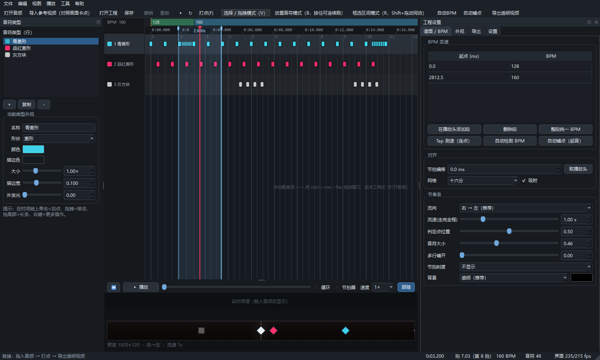

# 本工具的全部代码与文档由 DeepSeek 生成 
# All code and documentation in this project were generated by DeepSeek
# 节奏条工作室 · RhythmBar Studio


给**视频卡点**用的节奏条（音游打击条）编辑器：中间判定点、音符从两侧扫向判定线、
实时编辑、任意 BPM 变速、导出**背景透明视频**，直接叠到你的视频上。



---

## 30 秒上手

1. 双击 **`Start.bat`**（首次会自动装依赖）
2. 把 **音频或视频**拖进窗口（视频会抽画面 + 用它的音轨对音；可连续导入多段）
3. 按 **空格** 播放，跟着音乐按 **F** 打点 —— 或者点「自动检测 BPM」再按网格铺点
4. 在时间轴上微调，右侧面板调外观
5. **Ctrl+E** 导出透明视频，拖进剪辑软件，放在原视频**上层**

---

## 核心功能

### 多段媒体（音频 / 视频独立编辑）
* 导入视频时自动拆成**视频轨片段 + 音频轨片段**，两者默认链接；移动/切分其中一个，链接的另一个同步动
* 视频轨和音频轨各自横向拖动，片段之间允许留空；音频片段不会与其他音频片段重叠
* 拖动时自动吸附：当前时间、片段首尾、时间轴 0 点；按住 **Alt** 临时关闭吸附
* 右键片段可 **在当前时间切分**、**删除片段**；`Ctrl+K` 切分，`Del` 删除（没有选中音符时）
* 右侧 BPM 面板顶部的 **「在当前时间切分音视频」** 也能切分选中的片段
* 每段音频都有自己的 **BPM/偏移/节拍网格/波形/频谱**；视频轨只显示画面，音频数据在链接的音频片段上
* 片段位置随工程保存，下次打开自动重新解码恢复（文件找不到会提示跳过）

### 编辑（像音游铺面编辑器）
**三种鼠标模式**，用工具栏按钮 / `V` / `B` / `R` / `Tab` 切换：

| | 选择拖拽（V，默认） | 放置音符（B） | 框选区间（R） |
|---|---|---|---|
| 空白处单击 | 清除选择 | 在当前行加一个音符 | — |
| 空白处拖动 | 框选音符 | **沿网格连续刷音符**（整段一次撤销） | **选出时间区间** |
| 拖音符 | 移动 | 移动 | — |
| 悬停后拖右侧把手 | 拉成长条（hold） | 拉成长条 | — |

**标尺 / 波形 / 频谱 / 胶片条区域**：

* **直接拖动 = 移动当前时间**（自由定位，不吸附）——原来的手感
* **Shift + 拖动 = 框选时间区间**（等价于切到 R 模式再拖）
* 片段在各自轨道内拖动；拖动音频时，属于它的音符/网格一起移动，空档没有网格也没有音符
* 区间会高亮显示并标注时长，右键 →「在这个区间填充音符…」**会直接使用这段框选**，
  只需选间隔/类型再点「填充」；不用再点一次「用当前框选」
* 循环区间在图上会标「循环 x.xxs」；取消方式：取消勾选「循环」、播放菜单 →「清除循环」、
  或右键 →「清除循环区间」

| 其它操作 | 说明 |
|---|---|
| 按住 Ctrl | **临时切到放置音符模式**，松开恢复原来的模式（输入框里按 Ctrl 不受影响） |
| Ctrl+A | 全选 |
| 右键 | 改类型、量化、删除、长条增减一小节、区间填充/循环、从这一点填充 |
| F | **在播放位置打点**（卡点主力操作；空档不能打点） |
| Del / Ctrl+Z / Ctrl+Y | 删除选中音符 / 撤销 / 重做（没有音符选中时 Del 删除片段） |
| Ctrl+K | 在当前时间切分选中片段（链接的视频/音频一起切） |
| Ctrl+C / Ctrl+V / Ctrl+D | 复制 / 粘贴到鼠标位置 / 向后复制一份 |
| Ctrl+Q / Ctrl+M | 量化到网格 / 镜像选中区间 |
| 数字 1~9 / Q / W | 切换音符类型 / 上下换行 |
| 方向键（Shift 加速，Ctrl 移动选中） | 移动当前时间 / 微调选中音符 |
| Ctrl+滚轮 / Shift+滚轮 / 中键拖动 | 缩放 / 平移 / 平移 |
| L / M / S | 设循环 A-B / 节拍器 / 吸附开关 |
| Ctrl+0 | 缩放适应 |

### 判定点（中间那枚菱形）
* **常驻一枚 45° 灰白菱形**，不管有没有音符都在
* 音符打到它的瞬间，**按该音符的颜色闪一下**，同时放大 + 扩散圈，再平滑回灰白
* 可调：菱形颜色 / 大小、染色强度、染色时长、判定窗口、随 BPM 脉冲、命中扩散圈

### BPM 变速（每段音频独立）
* **先选中音频片段**（或选中链接的视频片段），右侧 BPM 表才可编辑
* 每段音频有自己的 **BPM 段列表、节拍偏移、网格、波形、频谱**；改一段不会影响其他段
* **Tap 测速 / 自动检测 BPM / 取当前时间对齐** 都只作用于当前选中的这一段
* 音符存的是**绝对毫秒**，改 BPM/偏移只影响网格，不会把你对好的音符挪走
* 片段之间空档没有网格、没有节拍器声，也不能打点/添加音符

### 批量铺点（框选区间）
**框选区间 → 填充**：Shift+拖动（或切到 R 模式）框出区间 →
右键「在这个区间填充音符…」，再选间隔（按节拍：每 1/4 拍、每 2 拍… /
按毫秒：每 125ms…）和类型；两种类型可自动交替，实时显示会生成多少个。
区间会自动使用当前框选，不需要再点一次「用当前框选」；填充只作用于框选所在的那一段音频，
不会跨越空档或改到其他片段。

### 参考视频对照（自带声音也能用）
* **Ctrl+Shift+V**（或文件菜单）导入 mp4/mov/mkv/avi/webm 等参考视频
* 视频画面进**视频轨**；自带声音自动拆成**音频轨片段**并与视频链接
* 时间轴从上到下依次是：**音符行 → 视频轨 → 音频轨（波形）→ 频谱图**
* 左下角**参考画面**跟随当前时间显示（胶片条 12fps）；暂停后自动取一帧精确画面（带缓存，拖动不卡）
* 视频路径随工程保存，下次打开自动恢复

### 频谱（对音主力）
* 时间轴上的**频谱图**按每个音频片段分别绘制：鼓点/音头都是一条条竖纹，
  把该片段的节拍网格线跟竖纹对齐就对上了；左侧标了 100 / 1k / 10k Hz 刻度
* **实时频谱条**：底部一条 56 段频谱，播放时实时跳动（低频在左）
* 视图菜单里可分别开关「时间轴显示频谱图」「实时频谱条」
* 频谱在后台按片段计算，算完自动出现，不卡界面

### 外观（可自由配色，内置 5 套预设）
* **底板**：颜色、不透明度（越低越不挡原视频）、顶部提亮、底部压暗、圆角、内缩、边缘高光、外阴影
* **判定点**：常驻标记可选菱形/方块/圆/长条，或导入自己的图片；命中染色（强度/时长）、竖线、判定窗口、BPM 脉冲、扩散圈
* **命中后残影**：还原参考图的「灰方块」，可设延迟多久开始变、多久消失，也可选原样式淡出或不显示
* **音符类型**：任意增删，每种可设形状（菱形/方块/圆/长条）、颜色、描边、大小、外发光，或导入自己的图片皮肤
* 导入图片后可拖动边框/角自由矩形裁剪，**裁剪框中心就是判定点/音符中心**；图片会复制到配置目录的 `skins/`（最长边最多 1024px）
* 预设：图中样式（暖灰半透明）/ 极简·无底板 / 霓虹发光 / 深色玻璃 / 纯白浅色

### 节奏条参数
流向（右→左 / 左→右 / 双侧向中心汇聚）、流速（走完全程的秒数）、判定点位置、
音符大小、多行铺开、节拍刻度、背景（透明 / 黑 / 白 / 自定义）。

### 导出
| 格式 | 透明 | 说明 |
|---|---|---|
| **MOV · ProRes 4444** | ✅ | PR / AE / 达芬奇 最稳 |
| **MOV · QuickTime 动画 (qtrle)** | ✅ | 剪映等兼容好，纯色图形体积小 —— **推荐先用这个** |
| WebM · VP9 alpha | ✅ | 体积最小，Chrome 及部分剪辑软件支持 |
| WebM · VP8 alpha | ✅ | 兼容更老解码器 |
| PNG 序列 | ✅ | 最保险，配合「导入序列」 |
| MP4 · 黑底 | ❌ | 剪辑里把混合模式设为「滤色 / 变亮」即可去黑底 |

* 尺寸预设 1920×120（条带）/ 2560×160 / 1280×80 / 3840×240 / 1920×1080，也可自定义
* 默认 **MOV qtrle + 30fps + 平衡质量**：兼容性和体积的折中；界面会显示“预计体积”
* 帧率、1~3× 超采样抗锯齿、质量档位、时间范围（整首 / 音符范围 / 自定义）
* 导出有进度、预计剩余时间和取消按钮；也可「导出当前帧 PNG」快速看效果

**体积参考（1920×120，3 分钟，实测演示工程）**

| 格式 | @60fps | @30fps | 说明 |
|---|---:|---:|---|
| MOV · ProRes 4444 | ~600 MB | ~300 MB | 最稳，但最大；只在 PR/AE/达芬奇需要时用 |
| MOV · qtrle | ~270 MB | ~135 MB | 剪映等兼容好，无损；默认格式 |
| WebM · VP9 alpha | ~13 MB | ~7 MB | **体积最小**，但先确认剪辑软件支持 alpha |
| MP4 · 黑底 | ~7 MB | ~4 MB | 最小，但无透明，需要滤色/变亮 |

> 内容越复杂（渐变、发光、粒子）体积越大；把 60fps 降到 30fps 基本直接减半，
> 把 1920×120 换成 1280×80 还能再降到约 45%。

---

## 界面语言（中文 / 日本語 / English）

菜单栏右侧 **语言 / Language / 言語** 里切换，**即时生效**，选择会记进设置，下次打开仍是这个语言。

* 静态文案（菜单、按钮、标签、下拉项、表头）由 `translate_tree()` 遍历控件树替换，
  每个控件第一次翻译时把中文原文记在 Qt 属性 `_zh` 上，之后切换都从原文重译
* 画布上直接绘制的文字（时间轴提示、状态栏、预览说明）在调用处用 `tr()` / `trf()`
* **音符类型的名字属于你自己的数据，不会被翻译**
* 新增 UI 文案时，把中文原文加进 `rbar/i18n.py` 的 `_TABLE` 即可（key 就是中文原文）

---

## 快捷键速查

```
空格            播放 / 暂停
F               打点（播放中随时按）
V / B / R / Tab 切换 选择拖拽 / 放置音符 / 框选区间
按住 Ctrl       临时切到放置音符（松开恢复；输入框里不抢）
Shift+拖动      框选时间区间（标尺、波形、频谱任意处）
Del             删除选中音符（没有选中音符时删除片段）
Ctrl+K          在当前时间切分选中片段
Ctrl+Z / Ctrl+Y 撤销 / 重做
Ctrl+A          全选
Ctrl+C / Ctrl+V 复制 / 粘贴到鼠标位置
Ctrl+D          向后复制一份
Ctrl+Q          量化到网格
Ctrl+M          镜像选中区间
1~9 / Q / W     切换音符类型 / 上下换行
← →             移动当前时间（Shift 大步，Ctrl 移动选中音符）
↑ ↓             选中音符换行
L / M / S       循环 A-B / 节拍器 / 吸附
Ctrl+0          缩放适应
Ctrl+E          导出视频
Ctrl+Shift+E    导出当前帧 PNG
Ctrl+Shift+O    打开音频
Ctrl+Shift+V    导入参考视频
Ctrl+U          检查更新
```

---

## 检查更新

菜单栏顶上单独一项 **检查更新**（快捷键 `Ctrl+U`），点一下就去 GitHub 看有没有新 Release。

* 每次启动也会自动查一次；**成功检查后 6 小时内不重复**。失败不会算“已检查”，
  会按 15 分钟 / 30 分钟 / 1 小时……退避重试，不会一直打 GitHub
* 默认先走 `releases.atom` 订阅源（不吃 API 配额）；只有发现新版本时才额外请求一次
  API 补附件列表，所以平时基本不会遇到 403
* 有新版本会弹窗显示版本号 + 更新说明，并提供「下载更新」「跳过此版本」「稍后提醒」，
  也可以「打开发布页」；点“跳过”后同一个版本不再打扰
* atom 和 API 都不通时，弹窗里可以直接点「打开 Releases 页面」手动看
* 想关掉自动检查：**设置** 标签里的「启动时检查更新」

---

## 环境要求

* Windows 10 / 11，或 macOS 12+
* Python 3.10+（Windows 安装时勾选 Add to PATH）
* **ffmpeg**（导出和音频解码都要用）
  * Windows 下载：<https://www.gyan.dev/ffmpeg/builds/>
  * macOS：`brew install ffmpeg`
  * 已经装了就自动找；找不到时在软件「设置」标签里手动指定 ffmpeg 路径

依赖只有两个：`PySide6`、`numpy`。

**Windows 源码运行：**

```
python -m pip install -r requirements.txt
python main.py
```

**macOS 源码运行：**

```bash
python3 -m venv .venv
.venv/bin/python -m pip install -r requirements.txt
.venv/bin/python main.py
```

首次启动会在**当前目录**生成 `rbar_settings.json`（已在 `.gitignore` 里，不会提交）：
保存 ffmpeg 路径、语言、音量、试听速度、延迟校准、打点间隔、最近打开、检查更新开关
和更新状态（上次成功/失败、跳过版本、稍后提醒、ETag），
以及**外观主题**（`theme`）和**导出默认值**（`export`，不含输出路径/时间范围）。
新建工程会自动套用这些默认值；改外观或导出设置后会写回文件。
可以直接用文本编辑器改，重启后生效；删掉它会用默认值重新生成。

> macOS 打包后的 `.app` 因为从 Finder 启动时当前目录是只读的 `/`，配置会存到
> `~/Library/Application Support/RhythmBarStudio/rbar_settings.json`。

### 打包

**Windows：** 双击 `build_exe.bat`（需要联网装 pyinstaller，产物是 `dist\节奏条工作室\` 文件夹，不是单文件）。
现在用 `package.spec` 排除了 QML/Quick/Pdf/WebEngine/软件 OpenGL 等无用 Qt 模块，实测文件夹
约 **125MB**（原来的 `--collect-all PySide6` 是 260MB 左右）；ffmpeg 仍需另外准备。

**macOS：**

```bash
chmod +x build_app.sh
./build_app.sh
```

脚本会创建 `.venv`、安装 `requirements.txt` 和 PyInstaller，生成
`dist/RhythmBarStudio.app` 与 `dist/RhythmBar-Studio-v{版本}-macOS-{架构}.zip`。
产物只包含当前 Mac 架构（Apple Silicon 和 Intel 需要分别打包）；ffmpeg 不打包，
需要 `brew install ffmpeg`。第一次打开被 Gatekeeper 拦时，右键 App →「打开」，或执行：

```bash
xattr -cr /Applications/RhythmBarStudio.app
```
